# TechCollab


**One workspace for freelance projects, tech events and developer communities.**

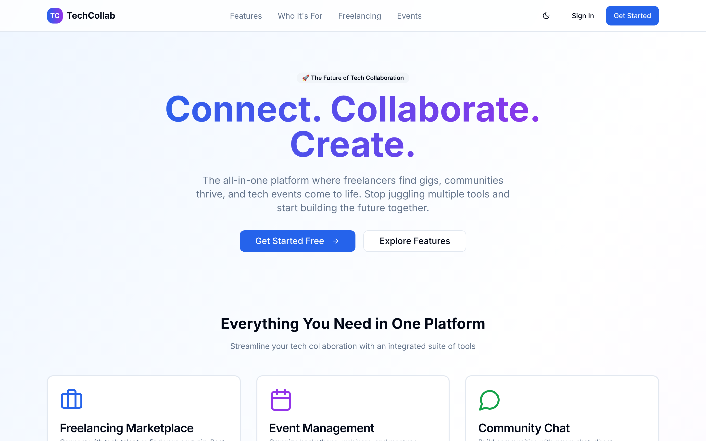

## Overview

People in tech usually juggle separate tools for finding freelance work, running meetups and hackathons, and
staying in touch with their community. TechCollab brings all three into one role-aware app:

- **Freelancers** browse projects, send proposals, keep a profile and portfolio, and discover events.
- **Clients** post projects, review proposals and host events.
- **Startups** recruit early team members, run hackathons and meetups, and build a community.

You pick a role when you sign up, and navigation, dashboards and permissions adapt to it.

> [!NOTE]
> **Project status: front-end prototype.** There is no backend. Accounts are stored in the browser's
> `localStorage`, and projects, events, messages and dashboard numbers are demo data. The UI, routing, role logic,
> validation and filtering are real and covered by tests. See [Known limitations](#known-limitations).

## Table of contents

- [Screenshots](#screenshots)
- [Features](#features)
- [Tech stack](#tech-stack)
- [Architecture](#architecture)
- [Getting started](#getting-started)
- [Configuration](#configuration)
- [Usage walkthrough](#usage-walkthrough)
- [Scripts](#scripts)
- [Testing](#testing)
- [Code quality](#code-quality)
- [Deployment](#deployment)
- [Project structure](#project-structure)
- [Troubleshooting / FAQ](#troubleshooting--faq)
- [Known limitations](#known-limitations)
- [Roadmap](#roadmap)
- [Contributing](#contributing)
- [License](#license)

## Screenshots

All screenshots were captured from the running app with demo data.

| Dashboard (client)                           | Dashboard (dark mode)                                          |
| -------------------------------------------- | -------------------------------------------------------------- |
| 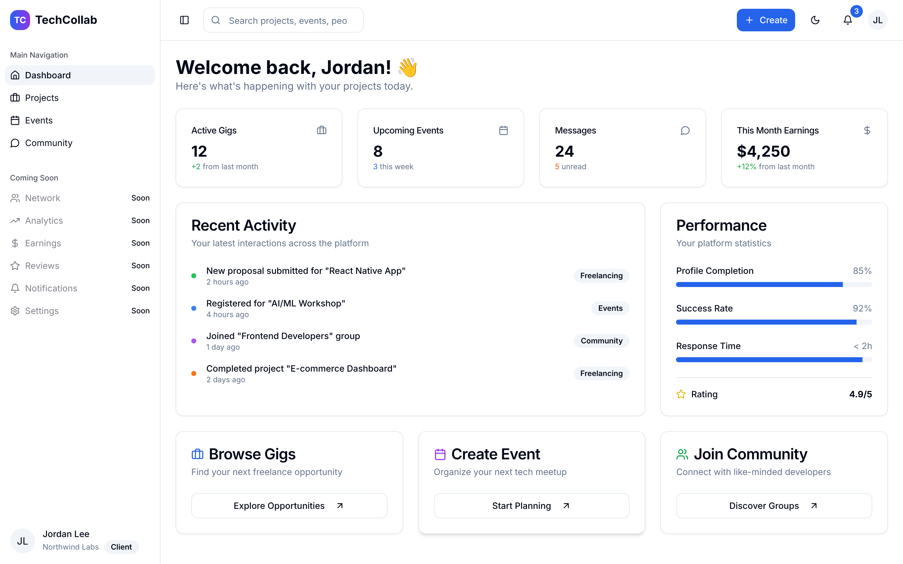 | 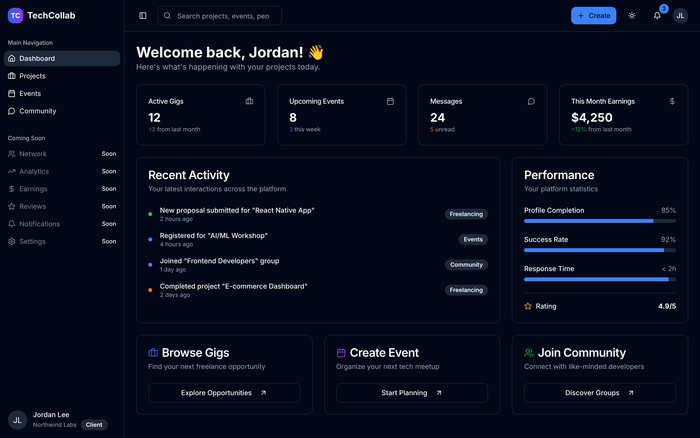 |

| Events hub                                 | Create event (host only)                                  |
| ------------------------------------------ | --------------------------------------------------------- |
| 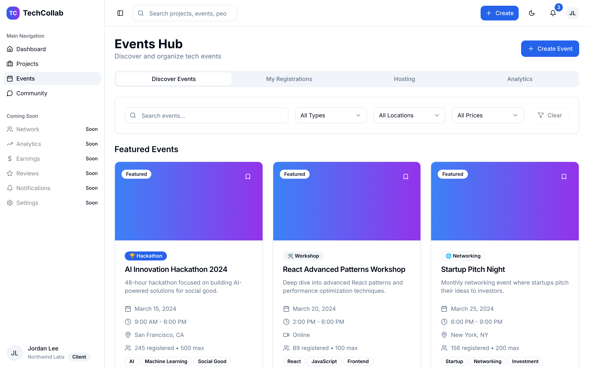 | 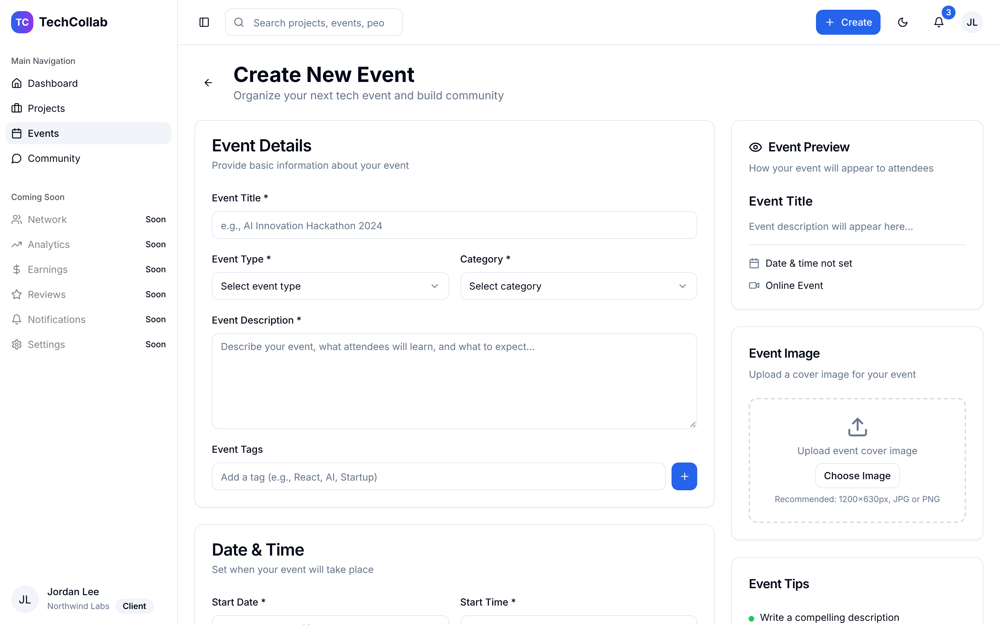 |

| Community chat                                         | Find work (freelancer, filtered by "react")  |
| ------------------------------------------------------ | -------------------------------------------- |
| 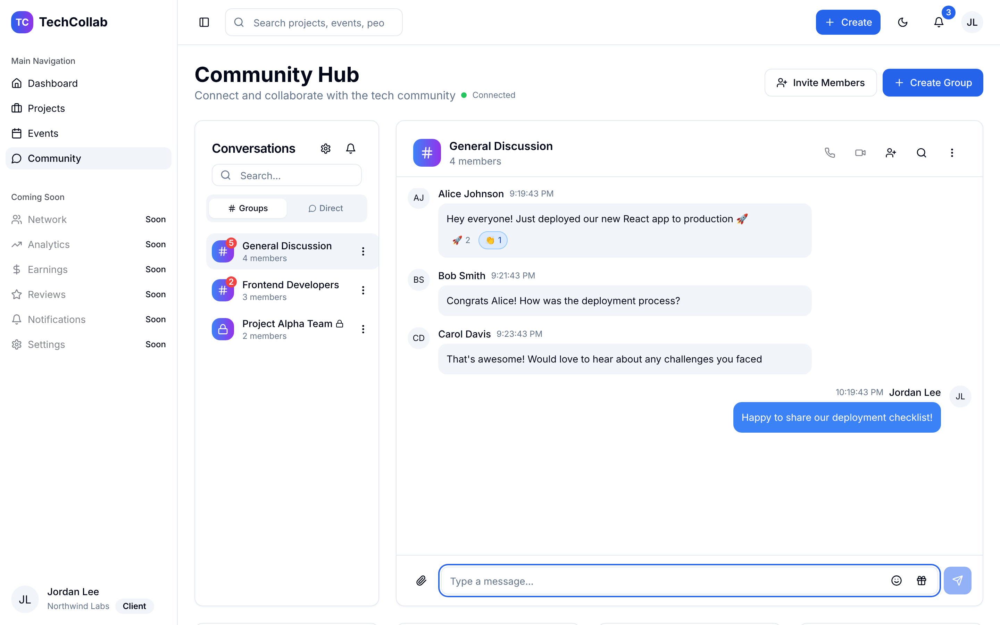 | 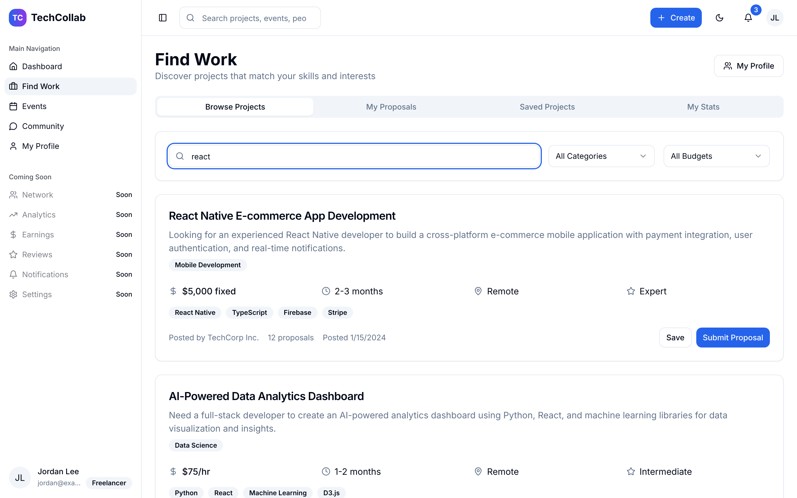 |

| Sign up with role selection             | Mobile: landing                                        | Mobile: dashboard                                          | Mobile: navigation                                    |
| --------------------------------------- | ------------------------------------------------------ | ---------------------------------------------------------- | ----------------------------------------------------- |
| 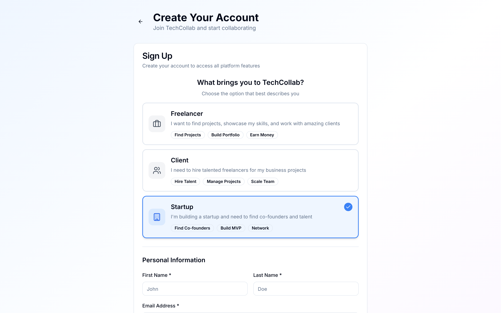 |  | 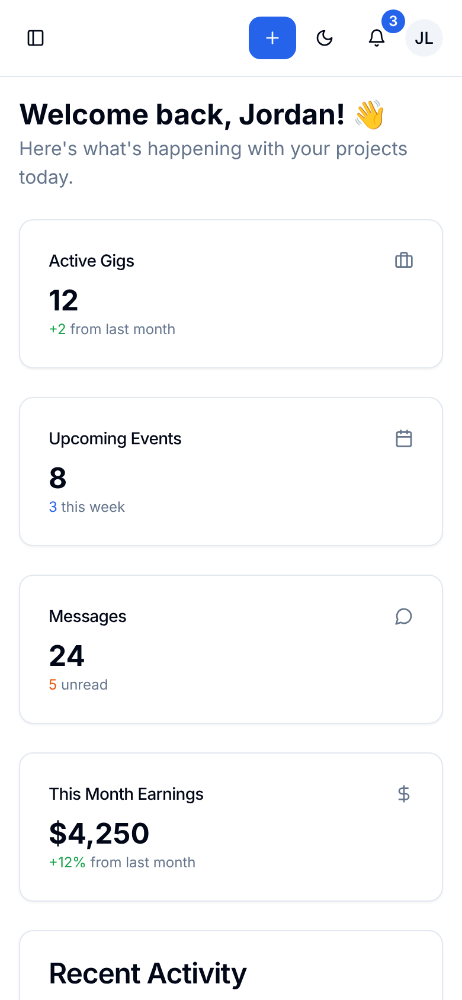 | 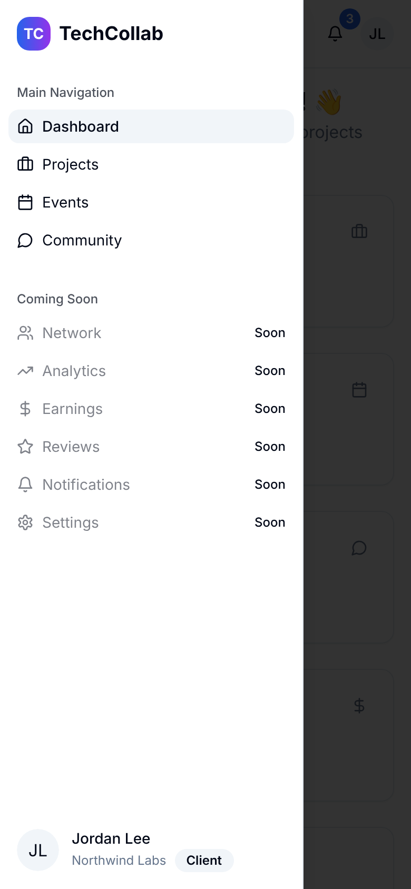 |

## Features

### Accounts and roles

- Sign up as **Freelancer**, **Client** or **Startup** using an accessible radio-group picker with arrow-key
  navigation.
- Inline, field-level validation:
  - required names
  - valid email
  - password of 8 or more characters, entered twice to confirm
  - company or startup name for those roles
  - terms acceptance
- Sign in with a previously registered email. **Continue with GitHub/Google (demo)** creates an instant freelancer
  session so you can explore without filling in a form.
- Dashboard routes are protected. Signed-out visitors are redirected to `/auth/signin?next=…` and returned to the
  page they asked for. Only same-origin paths are accepted, so the redirect can't be abused.
- Only clients and startups can create projects, create events or open the event management page.

### Freelancing marketplace

- **Freelancer view:** project listings with free-text search (title, description, skills), category filter and
  budget filter (fixed-price ranges or hourly). Includes an empty state, proposal submission, and a profile page
  with skills, portfolio and reviews.
- **Client/startup view:** _My Projects_, _Active Contracts_, _Proposals Received_ and _Analytics_ tabs, plus a
  multi-section "post a project" form.

### Events hub

- Discover featured and upcoming events with **working search, type, location and price filters** and a _Clear_
  action.
- Register in a modal or on the full registration page (`/events/[id]/register`) with ticket types.
- **Hosts** get a _Create Event_ wizard and a management view with tabs for attendees, analytics, communications,
  check-in and settings.
- Post-submit redirects deep-link into the right tab via `?tab=` (for example
  `/dashboard/events?tab=hosting`).

### Community

- Public and private groups, direct messages, unread badges and online status.
- Send, edit and delete messages and toggle emoji reactions. Message actions appear on hover and on keyboard
  focus.
- A "create group" dialog and a group management page (members, settings, moderation, analytics, activity).

### UI and accessibility

- Light and dark themes that follow the system setting, with a toggle.
- Responsive layout checked at 375 px, 768 px and 1440 px. The sidebar becomes a drawer on small screens.
- Semantic landmarks, a skip-to-content link, labelled icon-only buttons and visible focus rings.
- Loading skeletons for route segments, a 404 page, an error boundary with retry, and toasts for success and
  failure.
- Page titles (`%s | TechCollab`), meta description, Open Graph and Twitter cards with a generated OG image, an
  SVG favicon, and basic security headers.

## Tech stack

| Layer              | Technology                                                                                        |
| ------------------ | ------------------------------------------------------------------------------------------------- |
| Framework          | [Next.js 15](https://nextjs.org) (App Router)                                                     |
| UI library         | [React 19](https://react.dev)                                                                     |
| Language           | [TypeScript 5](https://www.typescriptlang.org) (strict)                                           |
| Styling            | [Tailwind CSS 3](https://tailwindcss.com) with CSS-variable design tokens                         |
| Components         | [shadcn/ui](https://ui.shadcn.com) on [Radix UI](https://www.radix-ui.com) primitives             |
| Icons              | [lucide-react](https://lucide.dev)                                                                |
| Theming            | [next-themes](https://github.com/pacocoursey/next-themes)                                         |
| Notifications      | [sonner](https://sonner.emilkowal.ski)                                                            |
| Testing            | [Vitest](https://vitest.dev), [Testing Library](https://testing-library.com), jsdom               |
| Linting/formatting | ESLint 9 (`next/core-web-vitals`, `next/typescript`), Prettier with `prettier-plugin-tailwindcss` |
| Package manager    | pnpm 10                                                                                           |

## Architecture

TechCollab is a client-rendered Next.js App Router app. Server components render static shells (layouts,
landing, legal pages, metadata). Interactive pages are client components that read from two React context
providers.

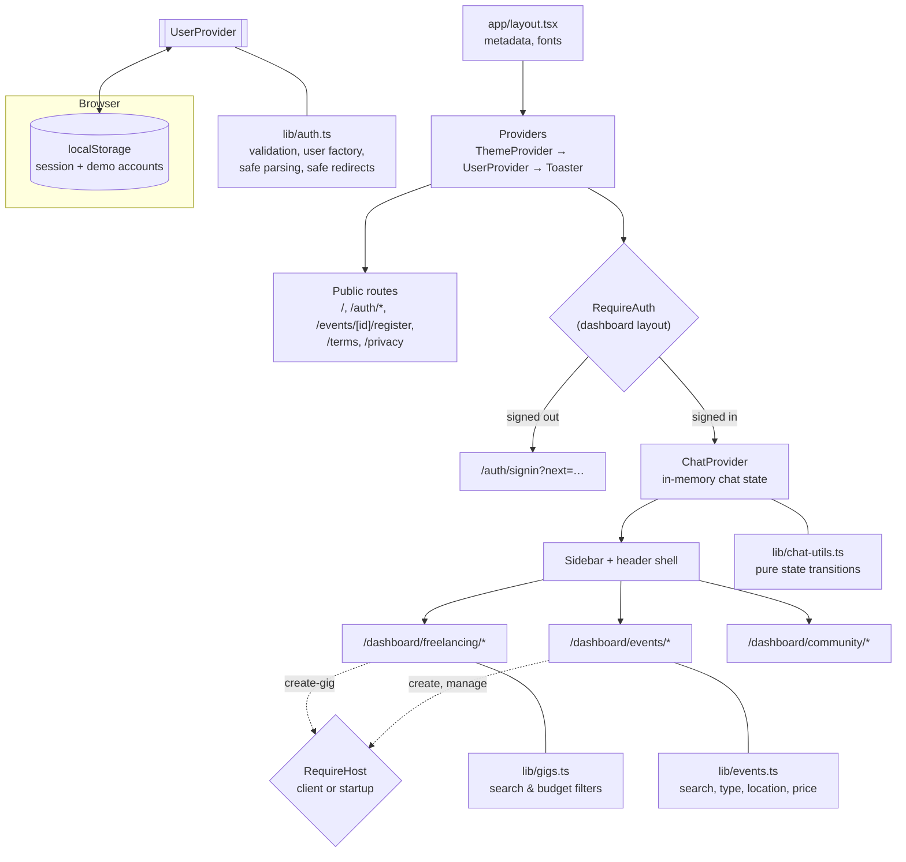

Key design decisions:

- **Logic lives in pure modules.** Validation, filtering and chat state transitions sit in `lib/*.ts` as plain
  functions with no React or browser dependencies. They're unit-tested, and the UI stays thin.
- **Defensive persistence.** `UserProvider` validates the shape of everything it reads from `localStorage`.
  Corrupt or outdated data is discarded instead of crashing the app, and storage errors (private mode, quota)
  are swallowed. Passwords are never written anywhere.
- **Swappable data layer.** `ChatProvider` exposes a stable interface (`sendMessage`, `addReaction`, `joinGroup`,
  …) over in-memory state, so a WebSocket or API client can replace it without touching pages.
- **Guards as components.** `RequireAuth` and `RequireHost` wrap route content, show a spinner while the session
  loads, and redirect with `router.replace`, so the Back button behaves.

## Getting started

### Prerequisites

- **Node.js 20.9 or newer** (developed on Node 22)
- **pnpm 10.** The repository pins `pnpm@10.28.0` in `packageManager`, so with Corepack:

  ```bash
  corepack enable
  ```

### Installation

```bash
# 1. Clone
git clone https://github.com/jeevithg090/v0-hwg.git
cd v0-hwg

# 2. Install dependencies (exact versions from the lockfile)
pnpm install --frozen-lockfile

# 3. (Optional) create a local env file
cp .env.example .env.local

# 4. Start the dev server
pnpm dev
```

Open <http://localhost:3000>.

### Running in production mode

```bash
pnpm build      # compiles, lints and type-checks
pnpm start      # serves on http://localhost:3000 (set PORT to change it)
```

## Configuration

All configuration is optional. The app runs with no environment variables and needs no secrets.

| Variable               | Required | Default                 | Description                                                                                                                        |
| ---------------------- | -------- | ----------------------- | ---------------------------------------------------------------------------------------------------------------------------------- |
| `NEXT_PUBLIC_SITE_URL` | No       | `http://localhost:3000` | Public base URL of the deployment. Used as `metadataBase` so Open Graph and Twitter image URLs are absolute. Set it in production. |
| `PORT`                 | No       | `3000`                  | Port for `pnpm start` / `pnpm dev` (standard Next.js behaviour).                                                                   |

## Usage walkthrough

1. **Create an account.** Open `/auth/signup` and pick a role. Fill in your name, email, password (8+ characters)
   and, for clients and startups, your company. Accept the terms and submit. You land on `/dashboard`, greeted by
   name.
2. **Explore as a host (client or startup).**
   - **Projects → Create Project** opens the posting form. Submitting returns you to _My Projects_.
   - **Events → Create Event** opens the event wizard. **Manage** on a hosted event opens attendee and analytics
     tabs.
3. **Explore as a freelancer.** Sign out from the avatar menu, go to `/auth/signin` and click **Continue with
   GitHub (demo)**.
   - **Find Work:** type `react` or pick _Hourly rate_ in the budget filter to narrow the list. Click **Submit
     Proposal** to apply.
   - **My Profile:** shows your skills and portfolio.
   - Freelancers who open `/dashboard/events/create` are redirected back to the events hub.
4. **Chat.** Open **Community**, pick _General Discussion_, type a message and press <kbd>Enter</kbd>. Hover over or
   tab to a message to react, edit or delete it. **Create Group** opens a dialog.
5. **Register for an event.** In **Events**, click **Register** on a card (modal), or visit `/events/1/register` for
   the full page.
6. **Deep links.** `/dashboard/events?tab=hosting` and `/dashboard/freelancing?tab=my-proposals` open those tabs
   directly.
7. **Sign in again.** Use the same email you registered with. Demo mode doesn't check passwords; see
   [FAQ](#troubleshooting--faq).

## Scripts

| Command             | Description                                     |
| ------------------- | ----------------------------------------------- |
| `pnpm dev`          | Start the Next.js dev server with hot reload    |
| `pnpm build`        | Production build (fails on type or lint errors) |
| `pnpm start`        | Serve the production build                      |
| `pnpm lint`         | Run ESLint on the whole project                 |
| `pnpm typecheck`    | Run `tsc --noEmit`                              |
| `pnpm test`         | Run the Vitest suite once                       |
| `pnpm test:watch`   | Run Vitest in watch mode                        |
| `pnpm format`       | Format all files with Prettier                  |
| `pnpm format:check` | Verify formatting without writing               |

## Testing

```bash
pnpm test                       # run all tests once
pnpm test:watch                 # re-run on change
pnpm vitest run lib/gigs.test.ts  # run a single file
```

Tests run in jsdom with Testing Library. `vitest.setup.ts` registers `jest-dom` matchers, clears
`localStorage` between tests and stubs `ResizeObserver` for Radix.

| Test file                      | What it covers                                                                                                                                                |
| ------------------------------ | ------------------------------------------------------------------------------------------------------------------------------------------------------------- |
| `lib/auth.test.ts`             | Sign-up and sign-in validation, user creation (no password persisted), demo users, initials, storage parsing, account upsert/lookup, open-redirect protection |
| `lib/user-context.test.tsx`    | Session restore, corrupt storage recovery, register → logout → sign-in, unknown email, provider misuse                                                        |
| `lib/gigs.test.ts`             | Category slugs, fixed-price range boundaries, hourly handling, multi-term search, combined filters, formatting                                                |
| `lib/events.test.ts`           | Free/paid detection, online and city matching, combined event filters                                                                                         |
| `lib/chat-utils.test.ts`       | Reaction toggling, message append/update/remove, membership, DM lookup, typing indicator text                                                                 |
| `app/auth/auth-pages.test.tsx` | Sign-up validation and success, keyboard role selection, sign-in with safe and unsafe `?next`, unknown-account error                                          |

## Code quality

- **TypeScript** runs in `strict` mode, and the build fails on type errors.
- **ESLint 9** uses a flat config (`eslint.config.mjs`) extending `next/core-web-vitals`, `next/typescript` and
  `prettier`. Unused variables are errors unless prefixed with `_`.
- **Prettier** settings: 120 columns, no semicolons, trailing commas, and Tailwind class sorting
  (`.prettierrc.json`).

Before pushing, run:

```bash
pnpm lint && pnpm typecheck && pnpm format:check && pnpm test && pnpm build
```

## Deployment

### Vercel (recommended)

1. Import the repository at <https://vercel.com/new>. The Next.js preset and pnpm are detected automatically.
2. Under **Environment Variables**, set `NEXT_PUBLIC_SITE_URL` to your production URL (for example
   `https://techcollab.example.com`).
3. Deploy. Every push to the production branch triggers a new deployment.

### Any Node.js host

```bash
pnpm install --frozen-lockfile
NEXT_PUBLIC_SITE_URL=https://your-domain.example pnpm build
PORT=8080 pnpm start
```

Put it behind a reverse proxy (nginx, Caddy) or a platform such as Render, Railway or Fly.io. `next.config.mjs`
already sends `X-Content-Type-Options`, `X-Frame-Options`, `Referrer-Policy` and `Permissions-Policy` headers and
disables the `X-Powered-By` header.

## Project structure

```text
.
├── app/                              # Next.js App Router
│   ├── layout.tsx                    # Root layout: fonts, metadata (title template, OG/Twitter), viewport
│   ├── providers.tsx                 # Client providers: theme → user session → toaster
│   ├── page.tsx                      # Public landing page
│   ├── icon.svg / opengraph-image.tsx# Favicon and generated 1200×630 social image
│   ├── not-found.tsx / error.tsx     # 404 page and error boundary
│   ├── terms/ privacy/               # Placeholder legal pages
│   ├── auth/
│   │   ├── page.tsx                  # Choose sign in or sign up
│   │   ├── signin/ signup/           # Auth forms
│   │   ├── forgot-password/          # Demo-mode explanation
│   │   └── auth-pages.test.tsx       # UI tests for both forms
│   ├── dashboard/                    # Authenticated area
│   │   ├── layout.tsx                # RequireAuth → ChatProvider → sidebar/header shell
│   │   ├── loading.tsx               # Skeleton shown while segments load
│   │   ├── page.tsx                  # Overview dashboard
│   │   ├── freelancing/              # Marketplace, create-gig (host), gig/[id]/apply, profile
│   │   ├── events/                   # Events hub, create (host), manage/[id] (host)
│   │   └── community/                # Chat, groups/[id] management
│   └── events/[id]/register/         # Public event registration page
├── components/
│   ├── ui/                           # shadcn/ui primitives (button, card, dialog, sidebar, …)
│   ├── app-sidebar.tsx               # Role-aware navigation, mobile drawer
│   ├── dashboard-header.tsx          # Search, Create menu, theme, notifications, account menu
│   ├── header.tsx                    # Public header with mobile menu and skip link
│   ├── auth-guard.tsx                # RequireAuth / RequireHost / FullPageSpinner
│   ├── role-selector.tsx             # Accessible role radio group
│   ├── password-input.tsx            # Password field with show/hide + FieldError
│   ├── event-registration-modal.tsx  # Quick event registration dialog
│   └── brand.tsx, theme-toggle.tsx, page-skeleton.tsx, simple-page.tsx, welcome-heading.tsx
├── hooks/
│   ├── use-mobile.tsx                # Breakpoint hook used by the sidebar
│   └── use-tab-param.ts              # ?tab= deep-link support without Suspense
├── lib/
│   ├── auth.ts                       # Auth domain logic (pure) + tests
│   ├── user-context.tsx              # Session provider over localStorage + tests
│   ├── chat-context.tsx              # Chat provider (in-memory)
│   ├── chat-types.ts / chat-utils.ts # Chat types and pure transitions + tests
│   ├── mock-chat-data.ts             # Seed users, groups, DMs and messages
│   ├── gigs.ts / events.ts           # Marketplace and event filtering + tests
│   └── utils.ts                      # cn() class-name helper
├── docs/screenshots/                 # README screenshots (captured from the running app)
├── public/placeholder.svg            # Placeholder image for demo portfolio items
├── eslint.config.mjs, .prettierrc.json, vitest.config.mts, vitest.setup.ts
├── next.config.mjs                   # Security headers, image settings
├── tailwind.config.ts                # Design tokens mapped to CSS variables
└── .env.example                      # Documented environment variables
```

## Troubleshooting / FAQ

**`pnpm: command not found`**
Run `corepack enable`, or install pnpm with `npm i -g pnpm@10`.

**"No account found for that email on this device" when signing in**
Demo accounts exist only in the browser where you created them. Sign up again, or use **Continue with GitHub
(demo)**. Clearing site data removes saved accounts.

**Does sign-in check my password?**
No. In demo mode only the email is matched, and passwords are never stored. Don't reuse a real password here.
Real authentication is on the [roadmap](#roadmap).

**I'm a freelancer and "Create Event" sends me back to the events hub**
That's intended: only clients and startups can host. Sign up again with one of those roles.

**My projects, events or messages disappear after a reload**
Only the session and account list are persisted. Created content and chat messages are in-memory demo state.

**Port 3000 is already in use**
Run `PORT=3001 pnpm dev`, or stop the other process.

**`pnpm build` fails with a type or lint error**
The build enforces both. Run `pnpm typecheck` and `pnpm lint` to see the details locally.

**Open Graph previews point at `localhost`**
Set `NEXT_PUBLIC_SITE_URL` to your public URL before building.

**The theme flashes or looks wrong**
The app follows your OS colour scheme until you use the toggle. `next-themes` stores the choice in
`localStorage`, so clearing site data resets it.

## Known limitations

- **No backend.** There's no database, API, real authentication, email or payments. Demo sign-in matches by email
  only.
- **Demo data.** Dashboard statistics, listings, notifications and chat history are hard-coded examples.
- **No real-time transport.** Chat works within a single browser tab, and typing indicators have no source.
- **Planned sections are not built.** Network, Analytics, Earnings, Reviews, Notifications and Settings are shown
  as "Soon" in the sidebar. Voice and video calls are disabled.
- **Mock detail pages.** Detail pages for groups, events and gigs ignore the `[id]` and show one sample record.
- **Upstream advisories.** `pnpm audit` reports 3 moderate advisories in `glob` (pulled in by Tailwind CSS 3 via
  `sucrase`). It's build-time only, and a fix requires a major upgrade that Tailwind 3 doesn't support.

## Roadmap

- Real authentication (for example Auth.js or a hosted identity provider) with hashed passwords and sessions
- Database-backed API (for example Postgres via Prisma or Drizzle) for projects, proposals, events and
  registrations
- Real-time chat over WebSockets or a hosted service behind the existing `ChatProvider` interface
- Build the "Soon" sections, starting with Notifications and Settings
- Detail pages driven by route `[id]` parameters
- End-to-end tests (Playwright) for the main flows
- Upgrade to Tailwind CSS 4

## Contributing

Contributions are welcome.

1. Fork the repository and create a feature branch (`git checkout -b feat/my-change`).
2. Install with `pnpm install` and make your change. Keep business logic in `lib/` as pure, tested functions where
   possible.
3. Add or update tests, then run `pnpm lint && pnpm typecheck && pnpm format:check && pnpm test && pnpm build`.
4. Use [Conventional Commits](https://www.conventionalcommits.org) for messages (`feat:`, `fix:`, `docs:`, …).
5. Open a pull request that explains what changed and how you verified it. Include screenshots for UI changes.

## License

No license has been chosen yet, so all rights are reserved by default. If you want others to reuse the code, the
[MIT License](https://choosealicense.com/licenses/mit/) is a simple, permissive option. Add a `LICENSE` file once
you've decided.

The project was originally scaffolded with [v0](https://v0.dev).
